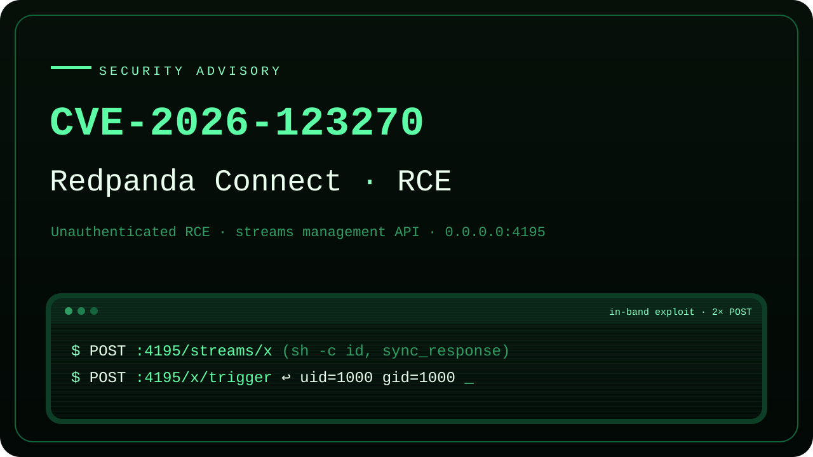
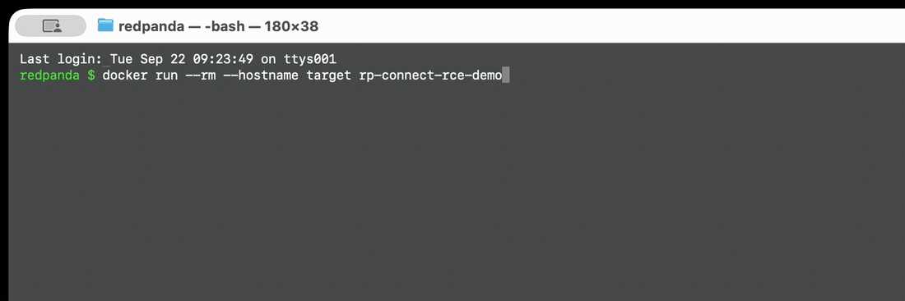
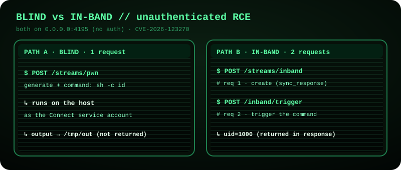

# Redpanda Connect: Unauthenticated Streams-Mode RCE (CVE-2026-123270)

<p align="center"></p>

Advisory and proof-of-concept exploit for [CVE-2026-123270](https://www.cve.org/CVERecord?id=CVE-2026-123270), an unauthenticated remote code execution vulnerability in the Redpanda Connect (formerly Benthos) streams-mode management API.

Coordinated through CERT/CC; tracked as CVE-2026-123270.

## Demo



The recording runs the PoC end to end against the official v4.109.0 binary inside a throwaway container. Step `[5]` shows the blind path (command output written to a file on the host) and step `[7]` shows the in-band path (command output returned directly in the HTTP response body). The `id` payload runs as the unprivileged service account the container starts as (`uid=1000(demo)`), confirming code execution as the Redpanda Connect process with no authentication.

## Summary

When Redpanda Connect runs in streams mode (for example `redpanda-connect streams`), it exposes a management HTTP API on `0.0.0.0:4195` with authentication disabled by default. Any client that can reach port 4195 can create a stream with an unauthenticated `POST /streams/{id}`. Pipeline configs may contain code-executing processors such as `command` and `subprocess`, so an attacker can submit a pipeline whose processor runs an arbitrary command. Instantiating the stream executes attacker-controlled code on the host, with no authentication, credentials, or user interaction. The command output can be returned directly in the HTTP response body over the same management port, so execution is not limited to blind operation.

This is a secure-by-default failure (CWE-306, Missing Authentication for Critical Function) that escalates to code execution (CWE-94 / OS command execution).

It is a distinct issue from CVE-2026-82266, which affects the separate Redpanda broker Admin API on port 9644. See the [advisory](rp_connect_rce_advisory_CVE-2026-123270.md) for the full comparison.

## Exploit flow



## Affected versions

Vulnerable by default on all releases up to and including v4.110.0. From v4.111.0 (2026-09-25) onward it is not vulnerable by default, though the same RCE is still reachable there if the management API is enabled with the `--bind-http` flag. See the [full advisory](rp_connect_rce_advisory_CVE-2026-123270.md) for the complete tested-version matrix (v4.39.0 through v4.117.0) and the details.

## Contents

| File | Description |
|---|---|
| `rp_connect_rce_advisory_CVE-2026-123270.md` | Full advisory: root cause, source references, impact, remediation, and disclosure timeline. |
| `rp_connect_rce_poc.py` | Self-contained Python 3 proof of concept. Standard library only, no third-party dependencies. |
| `docker/` | Containerized version of the PoC used for the demo recording. Runs the target and exploit as an unprivileged service account. |

## Proof of concept

The PoC downloads and checksum-verifies the official Redpanda Connect release binary, starts it in default streams mode, confirms the management API is reachable without authentication, and then demonstrates two execution paths:

1. Blind execution: an unauthenticated `POST /streams/{id}` runs a command whose output is written to a file on the host.
2. In-band execution: an `http_server` input paired with a `sync_response` output returns the command output directly in the HTTP response body.

Run it against a local instance:

```
python3 rp_connect_rce_poc.py
```

By default it targets `http://127.0.0.1:4195`. Edit the `TARGET` constant in the script to point at another host.

### Run in a container (as recorded in the demo)

The demo above runs the target and the PoC together inside a throwaway container, as an unprivileged, non-personal service account. This isolates the vulnerable service from your host and is the recommended way to reproduce the exploit. It is also why the `id` output in the recording reads `uid=1000(demo)` rather than a real user account.

From the `docker/` directory:

```
docker build -t rp-connect-rce-demo .
docker run --rm --hostname target rp-connect-rce-demo
```

`--rm` discards the container after each run, and `--hostname target` keeps the host machine name out of any command output. The image downloads and checksum-verifies the official release binary at build time, and the PoC re-verifies the same digest at run time.

The build defaults to `linux_arm64`. On an x86_64 host, override the two build args with the `linux_amd64` asset and its published digest. This single swap covers both the build-time checksum and the runtime verification:

```
docker build \
  --build-arg ASSET=redpanda-connect_4.109.0_linux_amd64.tar.gz \
  --build-arg SHA256=b73c40bf7ebe6acf690d38aa50c57deec5c754dc08d1a85091679b663eab9f4a \
  -t rp-connect-rce-demo .
```

See `docker/README.md` for details.

## Note

CVE-2026-123270 was published on 2026-11-09 and fixed by the vendor. The captured proof-of-execution output and the reporter's contact email are redacted from this public copy.

## Author

Adrian Pastor (GitHub: [@pagvac](https://github.com/pagvac))

## License

Released under the MIT License. See `LICENSE`.
